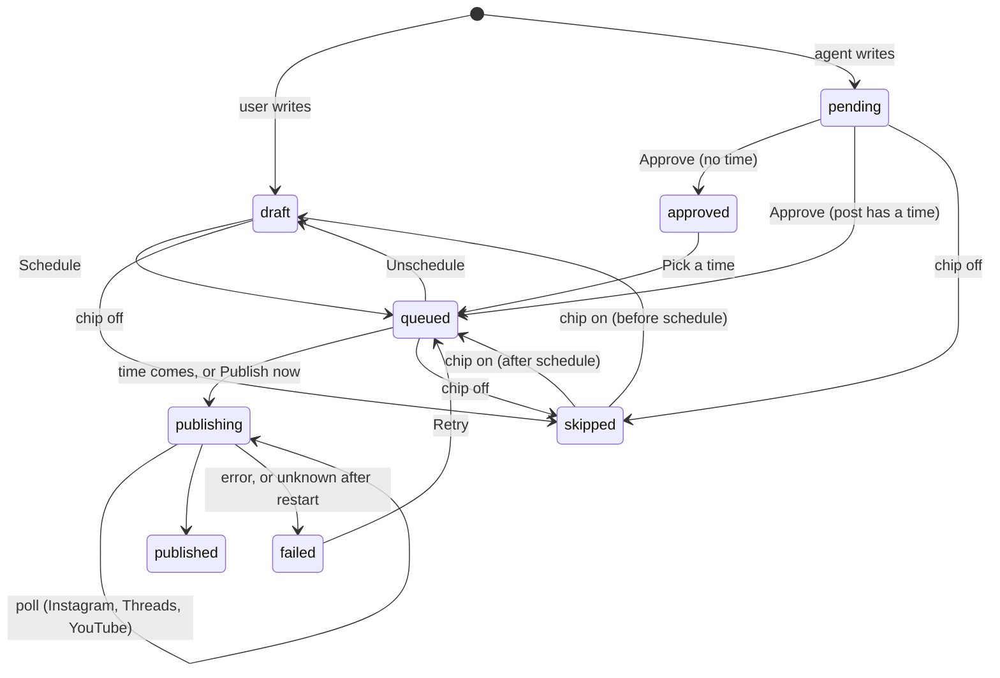
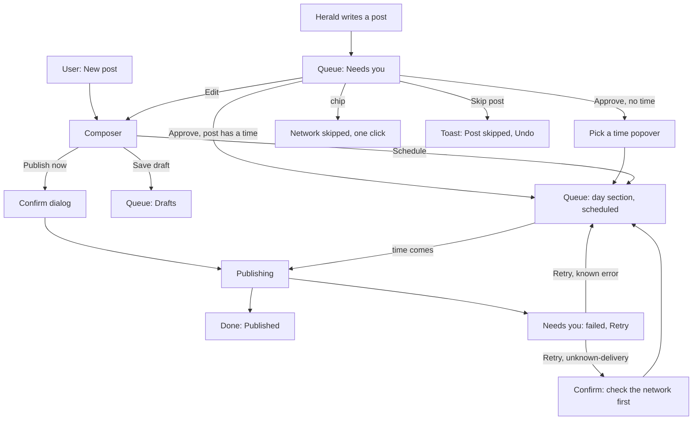

# Content manager: UX

Status: design draft for review. Owner: Loupe (design). Forge implements.
Contract: the approved v1 spec (`content-manager-spec.md`). Technical draft: [design.md](design.md).
Mockups (git ignores them): `.openbot-build/mockups/queue.html`, `composer.html`, `calendar.html`.

Rule for this document: reuse first. Each UI need names an existing component, or says "New" and why.

## 1. States

A post has an approval state. Each network variant has a delivery status. The queue shows one
derived status per post and one chip per variant.

| Layer | Values | Where stored |
| --- | --- | --- |
| Post approval | `none`, `pending`, `approved` | `content_posts.approval_state` |
| Variant status | `draft`, `queued`, `publishing`, `published`, `failed`, `skipped` | `content_variants.status` |



`Unschedule` and "chip on" are the reverse actions of Schedule and Skip. The spec endpoint list has
no `unschedule-post`. See [open question 1](#10-open-questions-for-forge).

### Derived post status (display)

Forge owns the pure function. This is the order the UI needs: the first rule that matches wins.

| # | Rule | Badge (`Badge` variant) | Text key |
| --- | --- | --- | --- |
| 1 | `approval_state = pending` | `primary-light` | `content.status.pending` |
| 2 | any variant `failed` | `destructive-light` | `content.status.failed` (plural) |
| 3 | any variant `publishing` | `secondary` | `content.status.publishing` |
| 4 | any variant `queued` | none, the row shows the time | `content.status.queued` (aria only) |
| 5 | `approval_state = approved` and no time | `primary-light` | `content.status.approved` |
| 6 | every variant `skipped` | `outline` | `content.status.skipped` |
| 7 | every non-skipped variant `published` | `success-light` | `content.status.published` |
| 8 | else | `secondary` | `content.status.draft` |

A pending post whose proposed time has passed shows `content.status.timePassed` in its meta line.
Approve then opens the time picker. It never publishes late without a new time.

### Network chip states

One chip per variant. The chip shows the network mark. Colour is never the only cue: each state
has a shape or a glyph too (same rule as the routine marks in `RoutineCalendar.tsx:613-629`).

| Variant status | Look | Glyph | Click |
| --- | --- | --- | --- |
| `draft`, `queued` | filled, `--openbot-bg-control-active` | none | skip this network |
| `skipped` | dashed outline, 0.6 opacity (as a paused run, `routine-calendar.css:257-266`) | none | include it again |
| `publishing` | `--openbot-accent-soft`, `--openbot-accent-text` | `Clock3` | none, tooltip only |
| `published` | `--openbot-success-soft`, `--openbot-success` | `Check` | none, tooltip only |
| `failed` | `--openbot-danger-soft`, `--openbot-danger-text` | `X` | none, tooltip shows the error |

A chip is a toggle button (`aria-pressed`) only while its variant is `draft`, `queued`, `pending` or
`skipped`. After that it is a status image with a label. Skipped networks do not appear on the
calendar (spec section 8).

## 2. User flow



1. Herald, or the user, makes a post. Herald's posts land in **Needs you** as `pending`.
2. The user approves once. One click on a chip skips that network. Skip post skips all of them.
3. One local time covers every network. The composer says so beside the time field.
4. At that time each network publishes on its own. Chips change one by one.
5. A failure moves the post to **Needs you** with the provider message and a Retry button. Nothing
   retries by itself.
6. After a restart, `unknown-delivery` failures need one more step: a confirm dialog says that
   Retry can post twice (spec risk 5), because X has no idempotency key.

## 3. Screen inventory

| ID | Screen | Kind | Opens from | Mockup |
| --- | --- | --- | --- | --- |
| S1 | Content: Queue (home) | window page, `titled` kind | rail, palette | `queue.html` |
| S2 | Content: Calendar | same page, second view | Queue/Calendar tabs | `calendar.html` |
| S3 | Composer (new, edit, review a pending post) | pane view with Back, as the schedule `onBack` | New post, Edit, a calendar entry | `composer.html` |
| D1 | Accounts | dialog | header Accounts button, empty state, Connect in composer | `queue.html` (states) |
| D2 | Confirms: publish now, delete, retry unknown, discard changes, disconnect | `ConfirmDialog` | actions | `queue.html`, `composer.html` (states) |
| T1 | Toasts: post skipped, approved for a time (each with Undo) | `toast` | actions | `queue.html` (states) |
| B1 | Banner: account signed out | `Alert` warning | queue and composer, top | `queue.html` |
| B2 | Notice: page is local only | `Alert` neutral | a joined server | `queue.html` (states) |

The page header row is the same in both views: Queue/Calendar tabs on the left, Accounts and New
post on the right. The calendar adds its own toolbar row below (range, Today, Day/Week/Month), the
same as `RoutineCalendar`.

### S1 Queue: sections

The order follows the Tasks page, which already groups by what a task needs
(`conversation.tasks.section.needsYou`, `TasksPage.tsx:630-700`).

1. **Needs you**: `pending`, any `failed`, approved with no time. Oldest first.
2. **Today**, **Tomorrow**, then one section per later day (heading from `format.date`): posts with a
   time and status queued or publishing, in time order.
3. **Drafts**: drafts with no time.
4. **Done**: published and fully skipped posts, newest first, faded as closed tasks are. Shows 5,
   then "Show all".

Row: time (tabular) | title (first line of the body) and a meta line with the chips, the agent
avatar and a short note | status badge | actions. Row actions by status:

| Status | Inline actions | Menu (`DropdownMenu`) |
| --- | --- | --- |
| pending | Approve (default), Edit | Skip post, Delete |
| approved, no time | Pick a time | Edit, Skip post, Delete |
| queued | none | Edit, Publish now, Unschedule, Skip post, Delete |
| publishing | none | none (menu disabled) |
| failed | Retry (outline) | Edit, Delete |
| draft | Edit | Publish now, Delete |
| published, skipped | none | Delete (local copy only); Restore for skipped |

The meta line of a failed row names each failed network and its provider message, for example
`X: Rate limit reached.` The provider text is shown as is; it is not translated.

### S3 Composer

Two columns at 920px and wider; one column below (`@container`, as the planner does).

- Left: Text, Image or video, When (Now / At a time, date, time, time zone line).
- Right: Networks. One row per network: checkbox, mark, name and handle, character count. Under a
  checked row: "Same text as above" with Edit text, or its own `Textarea` with "Use the main text"
  and "Copy from…".
- Footer: the first blocking reason on the left, Save draft (outline) and the main action (default)
  on the right. The main action is Schedule, Publish now (when Now is chosen; it opens a confirm),
  or Approve and schedule (for a pending post).

Network row rules:

| Condition | Row shows | Checkbox |
| --- | --- | --- |
| not connected | "Not connected", Connect button (opens D1) | disabled |
| gated (Meta review, Google verification) | "Not available yet", gate reason | disabled |
| image attached, network is YouTube | "Needs a video" | disabled |
| video attached, network takes images only | "Takes images, not video" | disabled |
| Instagram, no image | "Needs an image" | enabled; blocks the main action while checked |
| YouTube, video attached | Video title `Input` (required) | enabled |
| over the limit | count in danger, "{n} characters too many" | enabled; blocks the main action |

Leaving with unsaved changes opens "Discard changes?". The spec has no autosave, so this dialog
prevents data loss.

### D1 Accounts

One row per network: mark, name, handle, status badge, action. Status badges copy the mapping of
`ProviderAccountList.tsx:21-27`: connected `success-light`, signed out `warning-light`, error
`destructive-light`, not available `outline`. Actions: Connect, Reconnect, Disconnect (opens a
destructive confirm). Connect shows the `Button` loading state "Waiting for {network}…" with
Cancel, until the browser sign-in returns or times out (5 minutes, design.md section 7). The X row
first asks for the X app client ID (design.md section 7), in an `Input` in the row.

## 4. Component mapping

Paths are relative to the repository root. `@openbot/ui` primitives come from `packages/ui/src`.

| Need | Reuse (path) or New | Notes |
| --- | --- | --- |
| Page in the window, title in the top row | Reuse `WindowPage` union, `src/renderer/src/features/window/window-page-context.tsx:10-19`; `titled` kind; `.window-page` rules `window.css:358-380` | Add `"content"`, as schedule. Wiring list is in design.md section 9 |
| Rail button | Reuse `PageRail.tsx:373-386` (`packages/ui/src/features/window/`), icon `Megaphone` (in `@openbot/ui` icons) | Hidden for a joined server |
| Rail "needs you" dot | Reuse `.window-rail-notice` (`page-rail.css`) | On when Needs you count > 0. Aria label `content.rail.notice` |
| Palette entries | Reuse `GlobalSearchAction` (`packages/ui/src/components/GlobalSearch.tsx:72-82`), pattern `src/renderer/src/global-search-sources.ts:142-150` | See section 6 |
| Page title with host name | Reuse the pattern of `RoutineCalendar.tsx:258-286` and `TasksPage.tsx:863-905` | `Content / {host}` |
| Queue/Calendar switch; Day/Week/Month | Reuse `SlidingTabs` (`packages/ui/src/sliding-tabs.tsx`), as `RoutineCalendar.tsx:319-328` | |
| Buttons, icon buttons | Reuse `Button`, `IconButton` (`packages/ui/src/button.tsx`) | New post: `default` `sm`. Accounts: `outline` `sm`. Row actions: `default`/`outline`/`ghost` `xs` |
| Section heading with count | Reuse the pattern of `TasksPage.tsx:640-700` (`tasks.css:309-345`) | Copy the token values into `content.css`. Do not import `.tasks-page-*` sideways |
| Post row (two lines, actions) | Reuse `ItemGroup`, `Item size="compact"`, `ItemMedia`, `ItemContent`, `ItemTitle`, `ItemDescription`, `ItemActions` (`packages/ui/src/item.tsx`) | One `ItemGroup` per section. No new row layout |
| Post status | Reuse `Badge` (`packages/ui/src/badge.tsx`, styles `primitives.css:386-470`) | Variant table in section 1 |
| Network chip (toggle and status) | **New** `ContentNetworkChip`, `packages/ui/src/features/content/` | Composes `SocialNetworkMark` and the `Badge` palette. Toggle is a `Button` with `aria-pressed`. Skipped look copies the paused run |
| Network marks | Reuse `SocialNetworkMark` (`packages/ui/src/features/social-follow/social-marks.tsx:43`): x, threads, linkedin, instagram, facebook | Map `facebook_page` to `facebook`. Brand names are not translated (`social-networks.ts`) |
| YouTube mark | **Extend** `packages/ui/src/features/settings/brand-marks.tsx` with `YouTubeMark` (Simple Icons, CC0, as the others) | Do not add `youtube` to `SOCIAL_NETWORK_IDS`: that list drives the follow toast |
| Agent who drafted the post | Reuse `AgentAvatar` (`packages/ui/src/features/agents/AgentAvatar.tsx`) | In the meta line, with `content.queue.byAgent` as its label |
| Row menu | Reuse `DropdownMenu` (`packages/ui/src/complex.tsx:276`), icon `Ellipsis` | |
| Chip tooltip, error text | Reuse `LabelTooltip` (`packages/ui/src/tooltip.tsx`) | |
| Confirm dialogs | Reuse `ConfirmDialog` (`packages/ui/src/confirm-dialog.tsx:52`) | `tone="destructive"` for delete, disconnect, discard |
| Undo after skip or approve | Reuse `toast` (`packages/ui/src/toast.tsx`) | Action button "Undo" |
| Account signed out banner | Reuse `Alert` `tone="warning"` + `AlertActions` (`packages/ui/src/alert.tsx`), as `RoutineCalendar.tsx:361-372` | Not `ComposerErrorBanner`: it is chat-scoped and keyed by conversation |
| Load error | Reuse `Alert` `tone="danger"` + Retry, as `RoutineCalendar.tsx:361-372` | |
| Loading | Reuse `Skeleton` (`packages/ui/src/surface.tsx:49`) and an `sr-only` `role="status"` line, as `RoutineCalendar.tsx:339-358` | |
| Empty state | **New** `ContentEmpty` (small) | No generic empty state exists. `RoutineCalendarEmpty` and `TasksEmptyBoard` are bound to agents and routines. Spacing from `.routine-planner-empty-pitch` (`routine-calendar.css:570-612`) |
| Composer Back, heading focus | Reuse the `onBack` pattern of `RoutineCalendar.tsx:261-272` and `onSettled` focus (`:248-250`) | |
| Body text | Reuse `Field`, `Label`, `Textarea` (`packages/ui/src/form.tsx:104`) | Not `ComposerEditor`: it is the chat editor (mentions, pickers, send) |
| Character count | **New** `ContentCharacterCount` (thin) on `RadialProgress` (`packages/ui/src/radial-progress.tsx:17`, tones accent/warning/danger) + `Text variant="caption"` | Warning at 10% left, danger when over. The count comes from a per-network function, not `string.length`: X counts a link as 23 and some scripts as 2 |
| Network and account picker | Reuse `ItemGroup`/`Item` + `Checkbox` (`packages/ui/src/checkbox.tsx`) + `SocialNetworkMark` | v1 has one account per network, so the network row is the account picker |
| Own text per network | Reuse `Textarea`, `Button variant="link"`, `DropdownMenu` ("Copy from…") | |
| YouTube title | Reuse `Input` in `Field` (`packages/ui/src/form.tsx`) | |
| Image or video, pick or drop | **New** `ContentMediaField` | No drop zone exists. Preview reuses `ImageRemoveButton` (`packages/ui/src/image-remove-button.tsx:12`) and the attachment look of `ComposerAttachmentRow.tsx:63`. The file dialog is a renderer port, passed as a callback |
| Now or at a time | Reuse `RadioGroup` (`packages/ui/src/complex.tsx:478`) | |
| Date, time | Reuse `RoutineDateField` (`RoutineDateField.tsx:30`), `RoutineTimeField` (`RoutineTimeField.tsx:29`) | Both in `packages/ui/src/features/conversation/` |
| Time zone line | Reuse the pattern of `RoutineCalendar.tsx:285` | |
| Unsaved changes guard | Reuse `ConfirmDialog`; pattern `pendingExit`, `AgentRoutinesSettings.tsx:182` | |
| Calendar | **New** `PostCalendar` (`packages/ui/src/features/content/PostCalendar.tsx`), as design.md section 9 says | Same layout and classes as `RoutineCalendar`; dates from `@openbot/team-client/routine-calendar-dates`. A post is not a routine run, so do not change `RoutineCalendar` props. Network marks take the avatars slot |
| Calendar status mark | Reuse the `RoutineCalendarStatusMark` look (`RoutineCalendar.tsx:613-629`) | queued: accent dot; publishing: `Clock3`; published: `Check`; failed: `X`; pending: dashed, faded (as paused) |
| Accounts dialog | Reuse `Dialog` (`packages/ui/src/complex.tsx:212`) + `ItemGroup`/`Item` + `Badge` | Badge mapping from `ProviderAccountList.tsx:21-27` |
| Connect in progress | Reuse `Button` `loading` and `loadingLabel`, as `RoutineRunHistory.tsx:281-290` | |
| Local-only notice | Reuse `Alert` `tone="neutral"` | One sentence, no calls |

### Needs with no existing component

1. **Network chip** (`ContentNetworkChip`): toggle plus five states. Built only from existing parts.
2. **Character count** (`ContentCharacterCount`): thin wrapper on `RadialProgress` and `Text`.
3. **Media drop field** (`ContentMediaField`): no file drop zone exists in the app.
4. **Empty state** (`ContentEmpty`): no generic empty state exists.
5. **Post calendar** (`PostCalendar`): already planned in design.md; it copies the routine planner.
6. **YouTube mark**: one path added to `brand-marks.tsx`.

Each new shared component needs a Storybook story when it lands (spec section 8).

Note for Forge: the queue sections and the calendar copy existing feature CSS
(`.tasks-page-section*`, `.routine-planner-*`). Copy the token values into `content.css`. If you want one
rule set instead, lift those rules into a shared stylesheet without visual change. Do not import a
feature's CSS from another feature.

## 5. Empty, loading and error states

| Screen | Empty | Loading | Error |
| --- | --- | --- | --- |
| S1 Queue, no account | `ContentEmpty`: `content.empty.noAccounts.*`, action Connect accounts (D1) | Skeleton: 3 rows per section, 2 sections | `Alert` danger `content.error.loadFailed`, Retry |
| S1 Queue, no post | `ContentEmpty`: `content.empty.*`, action New post | same | same |
| S1 Queue, section empty | section is hidden | none | none |
| S1 Queue, account signed out | not empty: banner B1 on top, rows for that account show failed at publish time | none | none |
| S2 Calendar | no post with a time: `content.calendar.empty` with New post; week grid stays | Skeleton cells, as `RoutineCalendar.tsx:339-358` | `Alert` danger `content.calendar.loadFailed`, Retry |
| S2 Calendar, day view empty | `content.calendar.dayEmpty` | same | same |
| S3 Composer, no account | network rows show Connect; the main action is blocked with `content.composer.blocked.noNetwork` | post loads before the form shows: Skeleton fields | load: `Alert` danger + Back. Save: `Alert` danger above the footer, the form keeps all text |
| D1 Accounts | every row has Connect | Skeleton rows | sign-in timeout: inline `Text tone="danger"` in the row, `content.error.connectTimedOut` |
| Page on a joined server | B2: `content.page.localOnly` | none | none |

A failed write never clears the form or the queue row. A refresh started by `content:changed` keeps
the current list on screen (the `ScheduleView` rule, `SchedulePanel.tsx:118-140`).

## 6. Command palette

Two entries in `useGlobalSearchSources` (`src/renderer/src/global-search-sources.ts`), only for a local
server, next to the schedule entry:

| id | label | group | icon | keywords | run |
| --- | --- | --- | --- | --- | --- |
| `content` | `content.open` | `actions` | `Megaphone` | `content.palette.keywords` | open the Content page, Queue view |
| `content-new-post` | `content.action.new` | `actions` | `Plus` | `content.palette.keywords` | open the Composer for a new post |

## 7. Accessibility

- A chip toggle has `aria-pressed` and the label `content.chip.skip` or `content.chip.include`. A status
  chip has `role="img"` and `content.chip.label` ("X: Failed").
- The row status is in the row label. Tone is never the only cue (glyphs, dashed outline).
- The composer count is in `aria-describedby` of its `Textarea`. Over the limit sets `invalid`.
- The main action stays enabled; a click on a blocked action moves focus to the first problem and
  shows the reason. A disabled button cannot tell the user why.
- The Back button and the heading focus follow `RoutineCalendar`.

## 8. Interface text: `content.*` keys

Source file: `packages/i18n/src/messages/en/content.ts`, `defineMessages("content", {...})`. Style follows
`routine.ts`: dot-case, camelCase inside a segment. Network names are brand names and have no key.

One exception: the rail label goes in `app.ts` as `app.rail.content` ("Content"), beside the other
`app.rail.*` labels.

Reused, not new: `common.back`, `common.cancel`, `common.edit`, `common.delete`, `common.retry`,
`common.save`, `routine.calendar.today`, `routine.calendar.previousWeek`, `routine.calendar.nextWeek`,
`routine.calendar.previousMonth`, `routine.calendar.nextMonth`, `routine.calendar.previousDay`,
`routine.calendar.nextDay`, `routine.calendar.view`, `routine.calendar.viewDay`, `routine.calendar.viewWeek`,
`routine.calendar.viewMonth`, `routine.calendar.range`, `routine.calendar.more`, `routine.calendar.timeZone`,
`routine.history.today`, `routine.calendar.tomorrowAt`, `routine.card.nextRunAt`.

```ts
// Page, rail, palette
"content.title": "Content",
"content.open": "Open content",
"content.palette.keywords": "posts social media queue schedule publish",
"content.page.localOnly": "Content works only on the server on this computer.",
"content.rail.notice": { one: "{count} post needs you", other: "{count} posts need you" },
"content.view.label": "Content view",
"content.view.queue": "Queue",
"content.view.calendar": "Calendar",
"content.action.new": "New post",
"content.action.accounts": "Accounts",

// Queue
"content.queue.section.needsYou": "Needs you",
"content.queue.section.today": "Today",
"content.queue.section.tomorrow": "Tomorrow",
"content.queue.section.drafts": "Drafts",
"content.queue.section.done": "Done",
"content.queue.showAll": { one: "Show all ({count})", other: "Show all ({count})" },
"content.queue.showLess": "Show less",
"content.queue.loading": "Loading posts",
"content.queue.row": "{title}, {status}",
"content.queue.untitled": "Untitled post",
"content.queue.byAgent": "Drafted by {name}",
"content.queue.noTime": "No time",
"content.queue.failedNote": "{network}: {reason}",

// Post status
"content.status.draft": "Draft",
"content.status.pending": "Needs approval",
"content.status.approved": "Approved",
"content.status.queued": "Scheduled for {time}",
"content.status.publishing": "Publishing",
"content.status.published": "Published",
"content.status.partial": "Published on {done} of {total}",
"content.status.failed": { one: "{count} failed", other: "{count} failed" },
"content.status.skipped": "Skipped",
"content.status.timePassed": "Its time has passed",

// Network chips
"content.chip.label": "{network}: {status}",
"content.chip.skip": "Skip {network}",
"content.chip.include": "Post to {network}",
"content.variant.draft": "Draft",
"content.variant.queued": "Scheduled",
"content.variant.publishing": "Publishing",
"content.variant.processing": "{network} is processing the video",
"content.variant.published": "Published",
"content.variant.failed": "Failed",
"content.variant.skipped": "Skipped",

// Row actions
"content.action.approve": "Approve",
"content.action.pickTime": "Pick a time",
"content.action.skipPost": "Skip post",
"content.action.restore": "Restore",
"content.action.retryNetwork": "Retry {network}",
"content.action.unschedule": "Unschedule",
"content.action.publishNow": "Publish now",
"content.action.more": "More actions for {title}",

// Toasts
"content.toast.skipped": "Post skipped",
"content.toast.approved": "Approved for {time}",
"content.toast.undo": "Undo",

// Confirm dialogs
"content.confirm.publishNow.title": "Publish now?",
"content.confirm.publishNow.body": {
  one: "This posts to {count} network now. OpenBot cannot take it back.",
  other: "This posts to {count} networks now. OpenBot cannot take it back.",
},
"content.confirm.publishNow.action": "Publish",
"content.confirm.delete.title": "Delete this post?",
"content.confirm.delete.body": "OpenBot deletes its copy. Posts that are already published stay on the networks.",
"content.confirm.retryUnknown.title": "Check {network} first",
"content.confirm.retryUnknown.body": "OpenBot stopped while it posted to {network}, so it does not know if the post went out. Retry can post it twice.",
"content.confirm.retryUnknown.action": "Retry anyway",
"content.confirm.discard.title": "Discard changes?",
"content.confirm.discard.body": "Your changes to this post are not saved.",
"content.confirm.discard.action": "Discard",
"content.confirm.disconnect.title": "Disconnect {network}?",
"content.confirm.disconnect.body": "Scheduled posts for {handle} will fail until you connect it again.",
"content.confirm.disconnect.action": "Disconnect",

// Banners and errors (main sends error text with sourceText)
"content.banner.signedOut": "{network} signed you out. Posts for {handle} wait until you sign in again.",
"content.banner.reconnect": "Reconnect",
"content.error.loadFailed": "Could not load posts.",
"content.error.saveFailed": "Could not save the post. Your text is still here.",
"content.error.unknownDelivery": "OpenBot stopped during the post. Check {network} before you retry.",
"content.error.signedOut": "Sign in to {network} again.",
"content.error.connectTimedOut": "Sign-in to {network} timed out. Try again.",

// Empty states
"content.empty.title": "No posts yet",
"content.empty.body": "Write a post, or ask an agent to draft one. You approve each post before it goes out.",
"content.empty.noAccounts.title": "Connect a network first",
"content.empty.noAccounts.body": "OpenBot posts with your own accounts. Sign-in stays on this computer.",
"content.empty.noAccounts.action": "Connect accounts",

// Calendar
"content.calendar.loading": "Loading the calendar",
"content.calendar.loadFailed": "Could not load the calendar.",
"content.calendar.empty": "No scheduled posts in this range.",
"content.calendar.dayEmpty": "No posts on this day.",
"content.calendar.upcoming": "Next posts",
"content.calendar.upcomingEmpty": "Nothing is scheduled.",
"content.calendar.entry": "{title}, {time}, {status}",
"content.calendar.entryMeta": "{when} · {note}",
"content.calendar.networks": { one: "{count} network", other: "{count} networks" },

// Composer
"content.composer.titleNew": "New post",
"content.composer.titleEdit": "Edit post",
"content.composer.titleReview": "Review post",
"content.composer.writtenBy": "Drafted by {name}",
"content.composer.body": "Text",
"content.composer.bodyPlaceholder": "What do you want to say?",
"content.composer.length": { one: "{count} character", other: "{count} characters" },
"content.composer.media": "Image or video",
"content.composer.mediaChoose": "Choose a file",
"content.composer.mediaDrop": "or drop it here",
"content.composer.mediaHint": "One file goes to every network. An image goes to X, LinkedIn, Instagram, Threads and Facebook. A video goes to YouTube.",
"content.composer.mediaRemove": "Remove {name}",
"content.composer.networks": "Networks",
"content.composer.left": { one: "{count} character left", other: "{count} characters left" },
"content.composer.over": { one: "{count} character too many", other: "{count} characters too many" },
"content.composer.sameText": "Same text as above",
"content.composer.editText": "Edit text",
"content.composer.resetText": "Use the main text",
"content.composer.copyFrom": "Copy from…",
"content.composer.copyFromNetwork": "Copy from {network}",
"content.composer.needsImage": "Needs an image",
"content.composer.needsVideo": "Needs a video",
"content.composer.imagesOnly": "Takes images, not video",
"content.composer.notConnected": "Not connected",
"content.composer.connect": "Connect",
"content.composer.unavailable": "Not available yet",
"content.composer.videoTitle": "Video title",
"content.composer.when": "When",
"content.composer.whenNow": "Now",
"content.composer.whenLater": "At a time",
"content.composer.date": "Date",
"content.composer.time": "Time",
"content.composer.oneTime": "Every network posts at this time.",
"content.composer.saveDraft": "Save draft",
"content.composer.schedule": "Schedule",
"content.composer.approveSchedule": "Approve and schedule",
"content.composer.blocked.noNetwork": "Choose at least one network.",
"content.composer.blocked.overLimit": "Shorten the text for {network}.",
"content.composer.blocked.needsImage": "Add an image for Instagram, or turn Instagram off.",
"content.composer.blocked.noTitle": "Add a title for YouTube.",
"content.composer.blocked.pastTime": "Pick a time in the future.",

// Gates (composer and accounts)
"content.gate.meta": "Waits for Meta app review",
"content.gate.google": "Waits for Google verification",

// Accounts
"content.accounts.title": "Accounts",
"content.accounts.description": "OpenBot posts with these accounts. Sign-in tokens stay on this computer.",
"content.accounts.status.connected": "Connected",
"content.accounts.status.signedOut": "Sign in again",
"content.accounts.status.error": "Failed",
"content.accounts.status.unavailable": "Not available yet",
"content.accounts.connect": "Connect",
"content.accounts.connecting": "Waiting for {network}…",
"content.accounts.reconnect": "Reconnect",
"content.accounts.disconnect": "Disconnect",
"content.accounts.xClientId": "X app client ID",
"content.accounts.xClientIdHint": "From your app in the X developer portal.",
```

## 9. Decisions in this design

1. **Needs you comes first.** The spec wireframe shows a pending post under its day. The queue is
   the home screen for approval, so pending and failed posts go to the top, as on the Tasks page.
2. **Approve queues at once when the post has a time.** Else the post is `approved` and the row
   shows Pick a time. One click in the common case.
3. **Chip = one network. Skip post = all networks.** Both undo: the chip toggles back, Skip post
   has a toast with Undo, and a skipped post has Restore.
4. **Chips toggle only before publishing.** After that, Retry is a row action, not a chip click, so
   one control never has two meanings.
5. **Publish now always confirms.** It is outward-facing and cannot be undone. Schedule does not
   confirm, because Unschedule can undo it.
6. **Delete says what it does not do.** It deletes the OpenBot copy only.
7. **The composer is a pane view with Back, not a dialog.** Two columns need the width.
8. **Dark palette only in the mockups.** Light values come from `tokens-light.css`; no new token.

## 10. Open questions for Forge

1. **Unschedule and unskip.** The spec has ten endpoints and no `unschedule-post`. design.md has
   `content:unschedule-post`. AGENTS.md asks for reverse actions. Can `update-post` move a variant from
   `queued` to `draft` and from `skipped` back? If not, one endpoint is missing.
2. **Disconnect with scheduled posts.** This design leaves them `queued`; at publish time they fail
   with `content.error.signedOut`. Confirm, or pick another rule.
3. **Character count.** The count needs a per-network function next to the limits in
   `packages/contracts/src/ipc-content.ts`. X counts weighted characters. Who owns it, and is a
   simplified count acceptable for v1?
4. **Herald's proposed time.** Can an agent set `scheduled_for` on a pending post? Decision 2 assumes yes.
5. **design.md and the spec differ** on deliveries (`content:list-deliveries`, `needs-attention`). This
   document follows the spec: one variant is one delivery.
